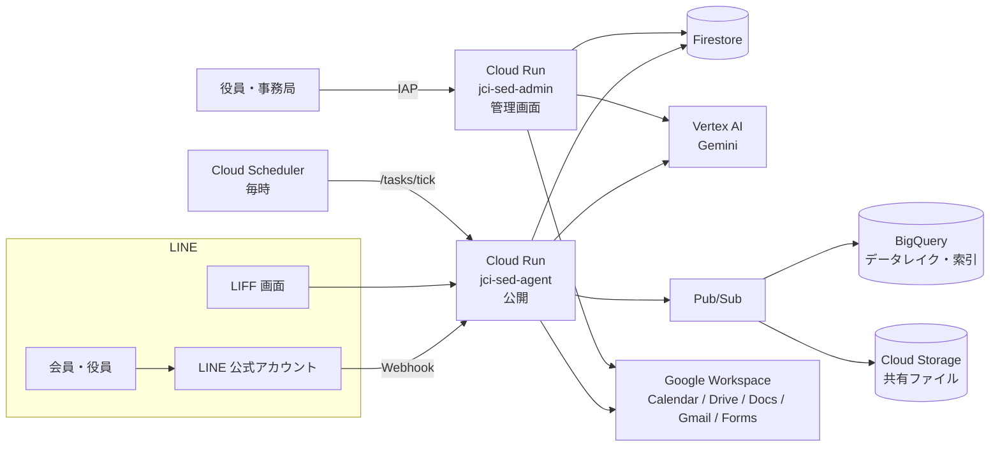

# JCI 専務理事AIエージェント

青年会議所（LOM）の**専務理事の事務局業務**を、LINE と Google Workspace の上で肩代わりする AI エージェントです。
会員とは LINE 公式アカウントでやり取りし、役員・事務局は Web の管理画面で状況を確認・操作します。

一般社団法人 猪苗代青年会議所の 2027 年度の運営で使いながら開発しています。
全国の LOM が自分の Google Cloud に立ち上げて使えるよう、オープンソース（MIT）として公開する準備を進めています。

> [!NOTE]
> 本ソフトウェアは公益社団法人日本青年会議所（日本JC）・国際青年会議所（JCI）の公式製品ではなく、
> これらの団体による承認・保証を受けたものではありません。

> [!IMPORTANT]
> 公開に向けた準備中です。LOM 名・ボット名などは設定で変えられます（[docs/setup.md](docs/setup.md#3-lom-の情報を設定する)）。
> 役職・会議体の名前など、まだ設定に移せていない値もあります。

## できること

| 分野 | 内容 |
|---|---|
| 予定・出欠 | 例会・理事会・五役会などの予定を登録し、対象者へ LINE で出欠確認。未回答者への自動催促、集計、五役へのサマリ通知 |
| 日程調整 | 候補日を LINE（LIFF）で回答してもらい、決めた日をそのまま予定と出欠に反映 |
| カレンダー | LOM の Google カレンダーと双方向に同期（Meet 付き・自動録画） |
| 議案 | 議案台帳で会議ごとの提出状況を管理。締切前後のリマインド、書式チェック、議案書（Google ドキュメント）の作成 |
| 対外連絡 | ブロック・地区・日本 JC からのメールを取り込み、対象の会員へ LINE で伝達 |
| アンケート | 例会アンケート（Google フォーム）の集計と未回答者への催促 |
| 資料・やり取りの検索 | LINE グループの会話・共有ファイルと Google ドライブの資料を索引にし、LINE で質問すると出典付きで回答（RAG） |
| LINE の画面 | 立場（会員・委員長・役員・専務）ごとのリッチメニュー、予約投稿、意見箱 |
| 管理画面 | 予定・出欠・会員・議案・LINE グループ・アンケートなどを扱う Web 画面（React）。Google アカウントでログイン（IAP） |

安全のための決まりごと:

- グループへの送信は取り消せないため、送信前に送り先を確認する画面を通す。
- 夜間（21:00〜8:00）は送らない。1 人あたり・全体の送信数に上限がある。緊急停止スイッチがある。
- 自由文のチャットからはデータを書き換えない（検索・回答のみ）。書き込みはリッチメニュー等のボタンから始めたときだけ。

## 構成



- **Cloud Run を 2 つ**動かします。同じイメージを使い、環境変数 `ROLE` で役割を分けます。
  - `jci-sed-agent`（公開）: LINE Webhook、LIFF、毎時の処理（`/tasks/tick`）。
  - `jci-sed-admin`（`ROLE=admin`、IAP で保護）: 管理画面 `/app` と管理 API `/api`。
- **Firestore** が予定・出欠・会員・議案などの正本です。
- **BigQuery** に LINE の受信イベント（データレイク）と資料の索引（ベクトル検索）を置きます。
- **Google Workspace** へは、サービスアカウントの権限借用（鍵なし）または LOM 公式アカウントの OAuth で接続します。
- AI は Vertex AI の Gemini を使い、タスクごとにモデルを選びます（[app/llm.py](app/llm.py) の `TASK_MODELS`）。

### ディレクトリ

```
app/            FastAPI アプリ（Webhook・管理 API・毎時処理・各機能）
app/static/     LIFF の画面（日程調整・予定と出欠など）
web/            管理画面（Vite + React + Tailwind）
scripts/        GCP のセットアップ、名簿・組織図の取込、リッチメニュー登録など
infra/bigquery/ データレイクのスキーマとビュー
tests/          pytest
docs/           要件・設計書・手順書
```

主なモジュールは [docs/README.md](docs/README.md) の一覧を参照してください。

## はじめる

### 手元で開発する

必要なもの: Python 3.12、Node.js 24（管理画面を触る場合）

```bash
python3 -m venv .venv
.venv/bin/pip install -r requirements-dev.txt

.venv/bin/ruff check app tests
.venv/bin/pytest
```

管理画面:

```bash
cd web && npm ci && npm run dev
```

テストは LINE・Firestore などの外部サービスをモックとインメモリ実装に置き換えて動きます。

### 自分の LOM に立ち上げる

[docs/setup.md](docs/setup.md) に、Google Cloud プロジェクトの作成から LINE の設定、初期データの投入までの手順があります。
設定できる環境変数とシークレットは [docs/configuration.md](docs/configuration.md) にまとめています。

## 運用

- `main` にマージすると、CI（ruff・pytest・管理画面のビルド）が通ったあと GitHub Actions が本番の 2 サービスへ自動でデプロイします（[.github/workflows/deploy.yml](.github/workflows/deploy.yml)）。認証は Workload Identity 連携で、サービスアカウントの鍵は作りません。
- 緊急停止・ロールバック・調査の手順は [docs/runbook.md](docs/runbook.md) にあります。

## ドキュメント

- [docs/README.md](docs/README.md) — ドキュメントの一覧
- [docs/requirements.md](docs/requirements.md) — 要件定義
- [docs/setup.md](docs/setup.md) — セットアップ手順
- [docs/configuration.md](docs/configuration.md) — 設定項目
- [docs/runbook.md](docs/runbook.md) — 運用手順

## ご意見・不具合の報告

- **[ご意見フォーム](https://docs.google.com/forms/d/e/1FAIpQLSeNLtWm7ROaQBxM1acLK0tuvkFAP1HMK8vWrHvWwsnBk7r_HQ/viewform)**（GitHub のアカウントは要りません）から、不具合・ほしい機能・質問を送れます。開発元が確認したうえで、このリポジトリの Issue として公開することがあります。
- GitHub のアカウントをお持ちの方は、[Issue](../../issues/new/choose) から直接どうぞ。
- 会員の名前・連絡先・LINE のグループ名などの個人情報は、どちらにも書かないでください。

## コントリビュート・セキュリティ

- 開発に参加する方は [CONTRIBUTING.md](CONTRIBUTING.md) を読んでください。
- 脆弱性を見つけた場合は、Issue ではなく [SECURITY.md](SECURITY.md) の方法で連絡してください。

## ライセンス

[MIT License](LICENSE) — Copyright (c) 2026 tentoTen Inc.（株式会社tentoTen）
