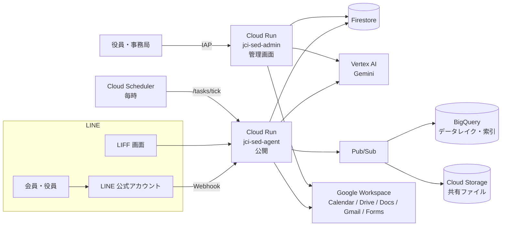

# JCI 専務理事AIエージェント

青年会議所（LOM）の**専務理事の事務局業務**を、LINE と Google Workspace の上で肩代わりする AI エージェントです。
会員とは LINE 公式アカウントでやり取りし、役員・事務局は Web の管理画面で状況を確認・操作します。

一般社団法人 猪苗代青年会議所の 2027 年度の運営で使いながら開発しています。
全国の LOM が自分の Google Cloud に立ち上げて使えるよう、オープンソース（MIT）として公開しています。

> [!NOTE]
> 本ソフトウェアは公益社団法人日本青年会議所（日本JC）・国際青年会議所（JCI）の公式製品ではなく、
> これらの団体による承認・保証を受けたものではありません。

> [!IMPORTANT]
> LOM 名・ボット名などは設定で変えられます（[docs/setup.md](docs/setup.md#3-lom-の情報を設定する)）。
> 役職・会議体の名前、議案のフォルダ名や様式など、まだ設定に移せていない値もあります。
> 立ち上げる前に「[前提と制限](#前提と制限)」と「[費用の目安](#費用の目安)」を読んでください。

## できること

| 分野 | 内容 |
|---|---|
| 予定・出欠 | 例会・理事会・五役会などの予定を登録し、対象者へ LINE で出欠確認。未回答者への自動催促、集計、五役へのサマリ通知 |
| 日程調整 | 候補日を LINE（LIFF）で回答してもらい、決めた日をそのまま予定と出欠に反映 |
| カレンダー | LOM の Google カレンダーと双方向に同期。設定すれば、予定に Meet を付けて自動録画にもできる（LOM 公式アカウントの OAuth・録画できる Google のプラン・Meet API が要る。[前提と制限](#前提と制限)） |
| 議案 | 議案台帳で会議ごとの提出状況を管理。締切前後のリマインド、書式チェック、議案書（Google ドキュメント）の作成 |
| 会議の案内 | 会議と上程される議案から、LINE の案内文と開催案内メールを作る。文面は「通知テンプレート」として管理画面で登録・編集できる。メールは LOM の Gmail に下書きとして作り、確かめてから送る |
| 議事録の下書き | 会議の Meet の録画（ドライブ）から、書き起こし・議案ごとの要点・宿題の案を AI で作る。人が確かめて直してから、会議体の LINE グループや委員長へ送る |
| 対外連絡 | ブロック・地区・日本 JC からのメールを取り込み、対象の会員へ LINE で伝達 |
| アンケート | 例会アンケート（Google フォーム）の集計と未回答者への催促 |
| 資料・やり取りの検索 | LINE グループの会話・共有ファイルと Google ドライブの資料を索引にし、LINE で質問すると出典付きで回答（RAG） |
| LINE の画面 | 立場（会員・委員長・役員・専務）ごとのリッチメニュー、予約投稿、意見箱 |
| 管理画面 | 予定・出欠・会員・議案・LINE グループ・アンケートなどを扱う Web 画面（React）。Google アカウントでログイン（IAP） |

安全のための決まりごと:

- グループへの送信は取り消せないため、送信前に送り先を確認する画面を通す。
- 夜間（既定は 21:00〜8:00）は送らない。時間帯は管理画面の「設定」で変えられ、使わないようにもできる。1 人あたり・全体の送信数に上限がある。緊急停止スイッチがある。
- 自由文のチャットからはデータを書き換えない（検索・回答のみ）。書き込みはリッチメニュー等のボタンから始めたときだけ。

## 前提と制限

- **Google Cloud の課金を有効にしたプロジェクト**が要ります（1 つの LOM に 1 つ）。費用は[次の節](#費用の目安)を見てください。
- **LINE 公式アカウントのプラン**: 出欠の依頼・催促・グループへの投稿などのお知らせ（Push）は、LINE の「メッセージ通数」に数えます。通数は、メッセージを受け取る人数で数えます。会員からの話しかけへの返信（応答）は数えません（[LINE Developers: Messaging API の料金](https://developers.line.biz/ja/docs/messaging-api/pricing/)）。
  無料のコミュニケーションプランは月 200 通までで、超えて送ることはできません。たとえば会員 40 人に月 5 回送ると 200 通になります。会員の数と送る回数に合わせて、ライトプラン（月 5,000 通）やスタンダードプラン（月 30,000 通、超えた分は従量）を検討してください（[LINE ヤフー for Business: 料金プラン](https://www.lycbiz.com/jp/service/line-official-account/plan/)、2026 年 11 月に確認）。
- **Meet の自動録画と議事録**: 会議の録画には、録画ができる Google のプランが要ります（Google Workspace の Business Standard 以上、Workspace Individual、2 TB 以上の Google One など。[Google Meet ヘルプ: ビデオ会議を録画する](https://support.google.com/meet/answer/9308681?hl=ja)）。
  予定に Meet を付けて自動録画にするには、ほかに LOM 公式アカウントの OAuth（`scripts/gmail_oauth_setup.py --with-calendar`）と Meet API（`meet.googleapis.com`）の有効化が要ります。
  議事録の下書きは録画の動画から作るので、Meet の文字起こし機能（有料プランの一部）は要りません。
- **まだ設定に移せていない値**があります（役職・会議体の名前、議案のフォルダ名・様式など）。必要なら fork して書き換えます（[docs/setup.md §3](docs/setup.md#3-lom-の情報を設定する)・[§6-2](docs/setup.md#6-2-議案まわりの前提フォルダ名と雛形)）。
- **ドライブの個人情報の除外は、名前で判断しているだけ**です（`名簿`・`住所録` などの語を含むフォルダ・ファイルを読まない）。中身は見ていません。個人情報の資料は、AI に読ませるフォルダに置かないでください（[docs/setup.md §6-1](docs/setup.md#6-1-ドライブの資料を読ませる)）。
- 立ち上げには、ターミナルでのコマンド操作（Google Cloud CLI・Python）が要ります。

## 費用の目安

本ソフトウェアは無料ですが、動かすための Google Cloud・LINE などの利用料は各 LOM の負担です。
主な費用と無料枠は次のとおりです（2026 年 11 月に各社の公式ページで確認。変わることがあります）。
Google Cloud の無料枠は、多くが**請求先アカウントごと**です。ほかのプロジェクトと同じ請求先アカウントを使うと、無料枠を分け合います。

| 項目 | 使いみち | 無料枠 |
|---|---|---|
| Cloud Run | 公開サービス・管理サービス | 毎月 200 万リクエスト、36 万 GB 秒（メモリ）、18 万 vCPU 秒（リクエスト単位の課金のとき）（[無料枠の一覧](https://docs.cloud.google.com/free/docs/free-cloud-features)） |
| Firestore | 予定・出欠・会員・議案などのデータ | 1 プロジェクトに 1 つのデータベースまで、保存 1 GiB、読み取り 5 万件／日、書き込み 2 万件／日、削除 2 万件／日、外向きの転送 10 GiB／月（[Firestore の料金](https://firebase.google.com/docs/firestore/pricing)） |
| Vertex AI（Gemini） | AI の回答・議案の確認・議事録など | 常時無料の枠はありません。使ったトークン数で課金します（[Vertex AI の料金](https://cloud.google.com/vertex-ai/generative-ai/pricing)）。管理画面の「送信の記録」に今月の AI の費用の概算が出ます |
| Cloud Storage | LINE で共有されたファイル、議事録の録画の一時置き場 | 無料枠は米国の一部のリージョンだけです。本システムは東京（`asia-northeast1`）に置くので、使った分だけ課金されます（[無料枠の一覧](https://docs.cloud.google.com/free/docs/free-cloud-features)） |
| BigQuery | LINE のやり取りの記録、資料の検索の索引 | 毎月クエリ 1 TiB、保存 10 GiB（[無料枠の一覧](https://docs.cloud.google.com/free/docs/free-cloud-features)） |
| Secret Manager | LINE・Gmail の鍵など | 有効なシークレットのバージョン 6 個、アクセス 1 万回／月（[無料枠の一覧](https://docs.cloud.google.com/free/docs/free-cloud-features)） |
| Pub/Sub | LINE のやり取りの記録、議事録の作業 | 毎月 10 GiB（[無料枠の一覧](https://docs.cloud.google.com/free/docs/free-cloud-features)） |
| Cloud Scheduler | 毎時の処理（1 ジョブ） | 請求先アカウントごとに 3 ジョブまで（[Cloud Scheduler の料金](https://cloud.google.com/scheduler/pricing)） |
| Cloud Build・Artifact Registry | デプロイ | 毎月ビルド 2,500 分（e2-standard-2）、保存 0.5 GB（[無料枠の一覧](https://docs.cloud.google.com/free/docs/free-cloud-features)） |
| LINE 公式アカウント | 会員への送信 | コミュニケーションプランは月 200 通まで無料（[前提と制限](#前提と制限)） |
| Google Workspace など | Meet の録画（使う場合だけ） | 録画には有料のプランが要ります（[前提と制限](#前提と制限)） |

実績の例（猪苗代 LOM、会員十数人。AI の費用は管理画面と同じ概算）:

- 議事録を作らない月の AI の費用は 1 ドル未満でした（2026 年 10 月は約 0.1 ドル）。
- 議事録の下書きは録画の書き起こしにトークンを多く使います。会議の議事録を何度か作り直した 2026 年 11 月（8 日まで）は約 4.9 ドルで、そのうち約 4.8 ドルが議事録でした。

`scripts/setup_ops.sh` で、月額の予算を超えそうなときに知らせるアラートを設定できます。

## 構成



- **Cloud Run を 2 つ**動かします。同じイメージを使い、環境変数 `ROLE` で役割を分けます。
  - `jci-sed-agent`（公開）: LINE Webhook、LIFF、毎時の処理（`/tasks/tick`）。
  - `jci-sed-admin`（`ROLE=admin`、IAP で保護）: 管理画面 `/app` と管理 API `/api`。
- **Firestore** が予定・出欠・会員・議案などの正本です。
- **BigQuery** に LINE の受信イベント（データレイク）と資料の索引（ベクトル検索）を置きます。
- **Google Workspace** へは、サービスアカウントの権限借用（鍵なし）または LOM 公式アカウントの OAuth で接続します。
- AI は Vertex AI の Gemini を使い、タスクごとにモデルを選びます（[app/llm.py](app/llm.py) の `TASK_MODELS`）。

### ディレクトリ

```
app/            FastAPI アプリ（Webhook・管理 API・毎時処理・各機能）
app/static/     LIFF の画面（日程調整・予定と出欠など）
web/            管理画面（Vite + React + Tailwind）
scripts/        GCP のセットアップ、名簿・組織図の取込、リッチメニュー登録など
infra/bigquery/ データレイクのスキーマとビュー
tests/          pytest
docs/           要件・設計書・手順書
```

主なモジュールは [docs/README.md](docs/README.md) の一覧を参照してください。

## はじめる

### 手元で開発する

必要なもの: Python 3.12、Node.js 24（管理画面を触る場合）

```bash
python3 -m venv .venv
.venv/bin/pip install -r requirements-dev.txt

.venv/bin/ruff check app tests
.venv/bin/pytest
```

管理画面:

```bash
cd web && npm ci && npm run dev
```

テストは LINE・Firestore などの外部サービスをモックとインメモリ実装に置き換えて動きます。

### 自分の LOM に立ち上げる

[docs/setup.md](docs/setup.md) に、Google Cloud プロジェクトの作成から LINE の設定、初期データの投入までの手順があります。
設定できる環境変数とシークレットは [docs/configuration.md](docs/configuration.md) にまとめています。

## 運用

- `main` にマージすると、CI（ruff・pytest・管理画面のビルド）が通ったあと GitHub Actions が本番の 2 サービスへ自動でデプロイします（[.github/workflows/deploy.yml](.github/workflows/deploy.yml)）。認証は Workload Identity 連携で、サービスアカウントの鍵は作りません。
- 緊急停止・ロールバック・調査の手順は [docs/runbook.md](docs/runbook.md) にあります。

## ドキュメント

- [docs/README.md](docs/README.md) — ドキュメントの一覧
- [docs/requirements.md](docs/requirements.md) — 要件定義
- [docs/setup.md](docs/setup.md) — セットアップ手順
- [docs/configuration.md](docs/configuration.md) — 設定項目
- [docs/runbook.md](docs/runbook.md) — 運用手順

## ご意見・不具合の報告

- **[ご意見フォーム](https://docs.google.com/forms/d/e/1FAIpQLSeNLtWm7ROaQBxM1acLK0tuvkFAP1HMK8vWrHvWwsnBk7r_HQ/viewform)**（GitHub のアカウントは要りません）から、不具合・ほしい機能・質問を送れます。開発元が確認したうえで、このリポジトリの Issue として公開することがあります。
- GitHub のアカウントをお持ちの方は、[Issue](../../issues/new/choose) から直接どうぞ。
- 会員の名前・連絡先・LINE のグループ名などの個人情報は、どちらにも書かないでください。

## コントリビュート・セキュリティ

- 開発に参加する方は [CONTRIBUTING.md](CONTRIBUTING.md) を読んでください。
- 脆弱性を見つけた場合は、Issue ではなく [SECURITY.md](SECURITY.md) の方法で連絡してください。

## ライセンス

[MIT License](LICENSE) — Copyright (c) 2026 tentoTen Inc.（株式会社tentoTen）
