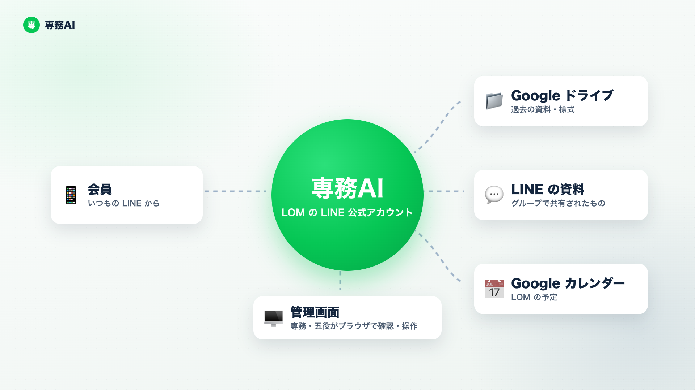
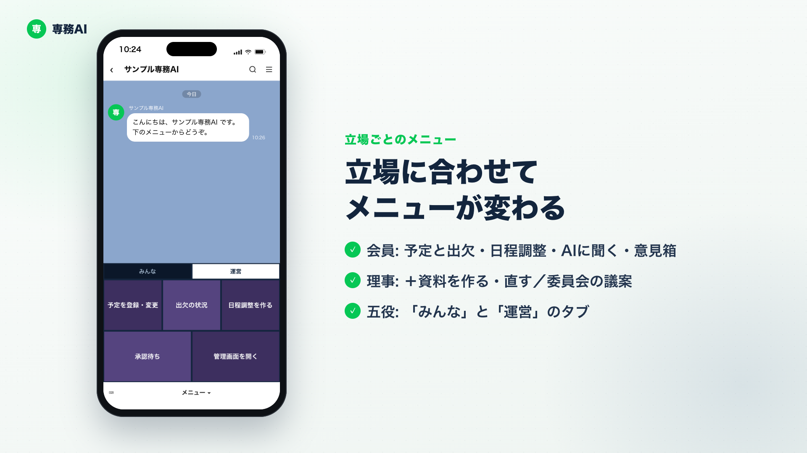
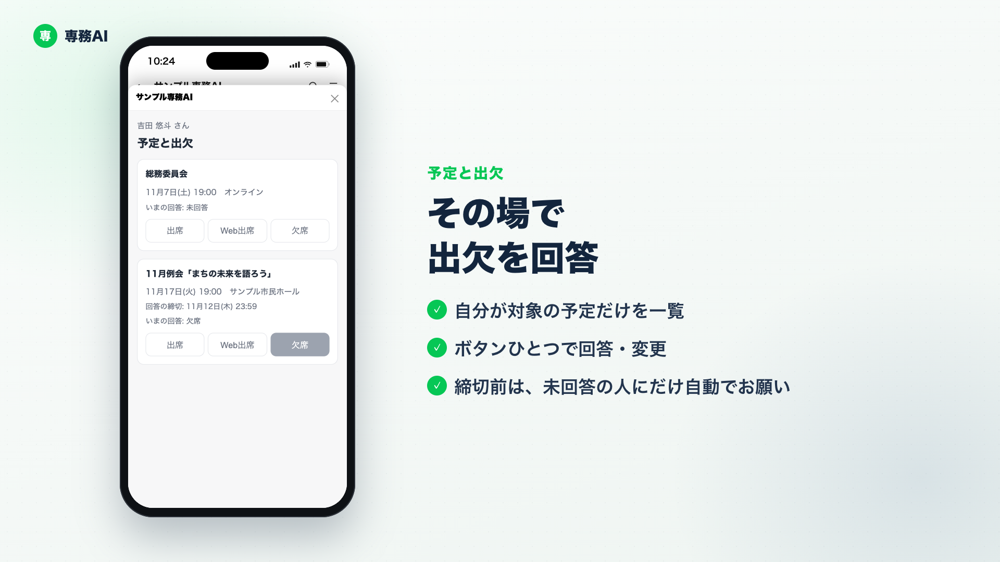
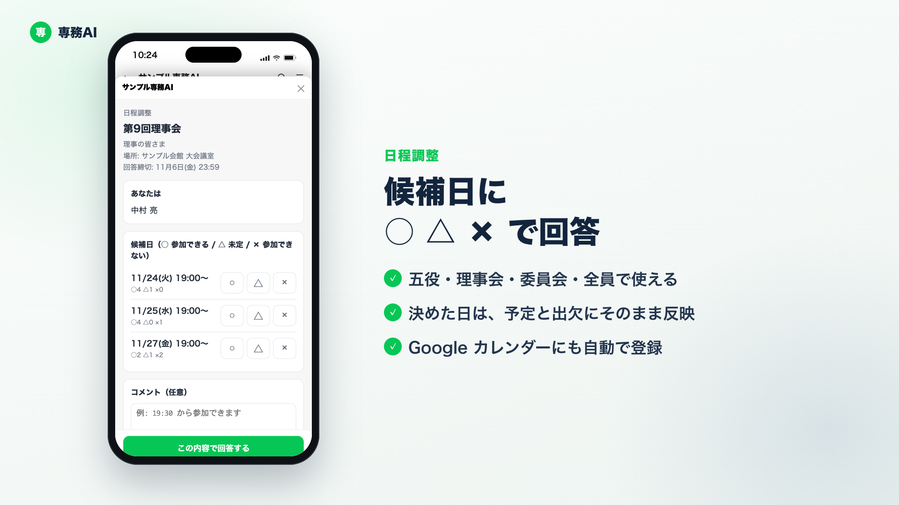
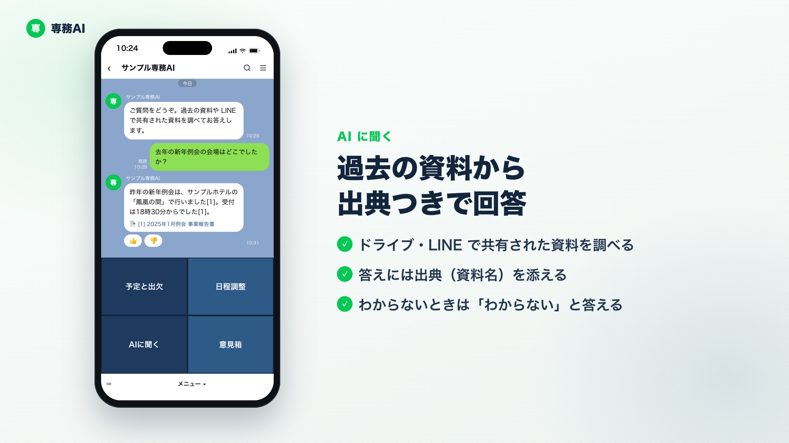
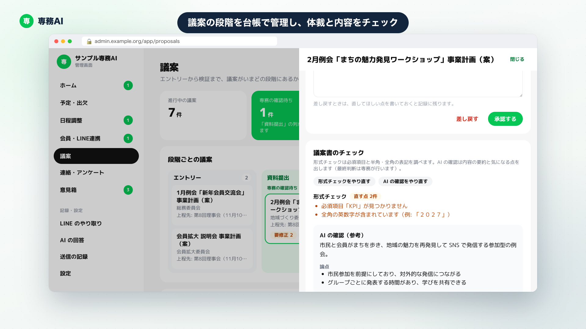
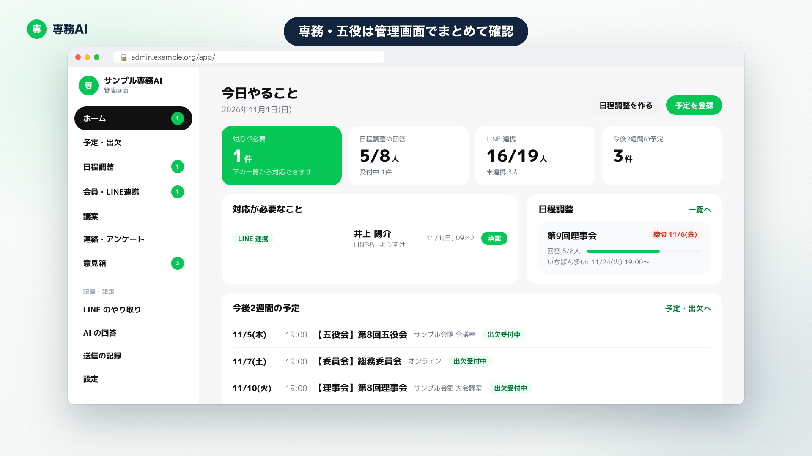

# 【青年会議所 | JC】地方で頑張る全ての専務へ - 専務AIを無料公開しました

<!-- 見出し画像: images/00_header.png（16:9）。note の「見出し画像」に設定してください -->

こんにちは。一般社団法人猪苗代青年会議所（福島県）で 2027 年度の専務理事を務める、遠藤孝行です。

専務を経験した方なら、きっと分かっていただけると思います。
例会の案内を送って、出欠を集めて、締切が近づいたら催促して。理事会の日程を調整して、委員会の議案を取りまとめて、会員からの「あれってどうなってる？」に答えて——。

専務の仕事は、ひとつひとつは難しくなくても、とにかく量が多い。しかも、本業を持ちながら、限られた時間でこなさなければなりません。

そこで、LINE で動く専務のアシスタント「**専務AI**」を作りました。猪苗代 JC で実際に使いながら育ててきたこの仕組みを、**オープンソースとして無料で公開**します。全国のどの LOM でも、自分たちの環境に導入して使えます。

---

## 2 分でわかる専務AI

<!-- ここにプロモーション動画を埋め込み（YouTube 等にアップロードした URL を貼る） -->

**専務AI は、LOM の LINE 公式アカウントとして動く AI です。**

- 会員は、いつもの LINE から使うだけ。新しいアプリは要りません。
- 専務AI は、Google ドライブの資料、LINE で共有された資料、Google カレンダーの予定をもとに動きます。
- 専務と五役は、ブラウザで開く「管理画面」でも、状況の確認や操作ができます。

大切にしているのは、「**AI が下書きし、人が決める**」ことです。
案内・催促・集計のような繰り返しの仕事は AI に任せて、方針を考えること、議論すること、仲間をつくることのように、人にしかできないことに時間を使えるようにする。それが専務AI の目的です。

---

## 専務AI でできること

### LINE のメニューは、立場ごとに変わります

会員・理事・五役で、表示されるメニューが変わります。

- **会員**: 予定と出欠／日程調整／AI に聞く／意見箱
- **理事（委員長など）**: ＋ 資料を作る・直す／委員会の議案
- **五役**: 「みんな」と「運営」のタブ。運営タブでは、予定の登録・変更、出欠の状況、日程調整を作る、承認待ち、管理画面を開く、が使えます。

### 予定と出欠 ― その場で回答、締切前は自動でお願い

［予定と出欠］を開くと、自分が対象のこれからの予定が並び、出席・欠席を選ぶだけで回答できます。あとから変更もできます。

締切が近づくと、**まだ答えていない人にだけ**、自動でお願いのメッセージが届きます。夜 9 時から朝 8 時までは送らないので、夜中に通知が鳴ることはありません。五役は［出欠の状況］から未回答の人を確かめて、その場で催促を送れます。

### 日程調整 ― LINE で ○△×、決めた日はそのまま予定に

五役は［日程調整を作る］から、対象者と候補日を入れるだけ。五役会・理事会・委員会・会員全員と、対象者に合ったグループに案内が届きます。

会員は候補日ごとに ○・△・× で回答します。日にちを決めると、その予定が［予定と出欠］に入り、○ の人は出席、× の人は欠席として写されます。Google カレンダーにも自動で登録されます。

### AI に聞く ― 過去の資料を調べて、出典つきで回答

「去年の新年例会はどうやった？」「この様式はどこにある？」——こうした質問に、ドライブの過去の資料や、LINE で共有された資料を調べて答えます。答えには出典がつくので、元の資料をすぐに開けます。

- 五役向けの資料は五役にだけ使います。
- 名簿や住所録のような個人情報は、そもそも検索の対象にしません。
- 資料に書かれていないことは推測で答えず、「わからない」と答えます。
- グループで専務AI をメンションして質問することもできます（そのグループのやり取りと、全員向けの資料だけを使って答えます）。

### 議案 ― LINE で AI と作り、AI がチェックし、段階を管理する

議案まわりは、専務の負担がいちばん大きいところかもしれません。専務AI では、議案書の作成から、チェック、上程までの管理を一つの流れにしました。

**① 議案書は、LINE で AI と話しながら作れます**

委員長などの理事は、［資料を作る・直す］から委員会サマリーや事業計画書を選び、「こんな例会にしたいので、背景と目的を書いて」と話しかけるだけ。AI が案を作り、本人が［書き込む］を押したときだけ Google ドキュメントに反映されます。［さっきの変更を戻す］で元に戻すこともできます。

新しい事業計画書も、委員会と年間スケジュールの例会・事業をボタンで選ぶだけで、テンプレートから作れます。委員会名や委員長などの基本情報も自動で記入されます。

**② 議案チェックは、体裁は機械で、内容は AI が整理**

提出された議案は、必須の項目が抜けていないか、英数字の全角・半角が混ざっていないかといった**体裁をチェック**します。さらに **AI が内容を読み込み、要約と「気になる点」を整理**します（雨天時の対応が書かれていない、KPI の測り方が不明、など）。

体裁の指摘や読み込みのような細かな確認は AI に任せて、専務と五役は、事業の目的や中身といった**本質的な議論に時間を使える**ようになります。もちろん、最終的な判断は人が行います。

**③ 段階を台帳で管理するので、上程漏れがありません**

議案は、エントリー → 資料提出 → 五役会 → 理事会上程 → 審議結果 → 事業実施 → 報告 → 検証 の段階で、会議ごとに台帳で管理します。どの議案がいまどこにあるかが一目でわかります。

委員長は［提出する］を押すだけで専務に知らせが届き、締切を過ぎても提出されていない議案は、担当の副理事長に自動で知らせて提出予定日を答えてもらいます。**上程漏れや、提出の催促し忘れを防げます。**

### 意見箱 ― みんなの声で育てる

不具合・ほしい機能・使いにくいところを、LINE から送れます（匿名も可）。届いた意見は AI が分類・要約して、専務に届きます。

### 管理画面 ― 専務・五役はまとめて確認

許可した Google アカウントだけがログインできる管理画面で、今日やること、予定と出欠の集計、日程調整、会員の LINE 連携、議案、外部からの連絡とアンケート、意見箱、送信の記録などを確認できます。万が一のときは［送信の一時停止］で、LINE への自動送信をすぐに止められます。

---

## 安心して使えるしくみ

LOM の会員の情報を扱う仕組みなので、安全にはこだわりました。

- **ふだんのチャットは「調べて答える」だけ**。会話から勝手にデータを書き換えることはありません。
- **書き換えや送信は、ボタンを押して確認したあとだけ**。グループへの送信は取り消せないので、送り先を確かめる画面を必ず通します。
- **操作はすべて記録**に残ります。
- データは、**自分の LOM の Google Cloud（東京リージョン）**に保存され、AI の学習に使われることはありません。

---

## 使い方を網羅したマニュアル動画

<!-- ここにマニュアル動画を埋め込み（YouTube 等にアップロードした URL を貼る） -->

約 9 分で、LINE 連携のしかたから各機能、管理画面、導入のしかたまで、順番に説明しています。章ごとに見られるよう、YouTube の説明欄に目次（チャプター）を入れています。

---

## 導入のしかた

専務AI は、MIT ライセンスのオープンソースとして GitHub で公開しています。

https://github.com/tentoTen-Inc/jci-senmu-ai

### 必要なもの

- **Google Cloud のプロジェクト**（LOM ごとに 1 つ。利用した分だけの従量課金です）
- **LINE 公式アカウント**（Messaging API を使います）
- **LOM 公式の Google アカウント**（カレンダー・ドライブ・Gmail の持ち主として使います）

### 進め方

GitHub の「セットアップ手順」（https://github.com/tentoTen-Inc/jci-senmu-ai/blob/main/docs/setup.md）に、次の順でまとめています。

1. Google Cloud の準備（API の有効化、データベース、サービスアカウント）
2. LINE の設定（Messaging API、LINE ログイン・LIFF）
3. LOM の情報の設定（LOM 名・ボット名など）
4. デプロイ（会員向けのサービスと、管理画面のサービス）
5. 初期データ（会員名簿・組織図の取り込み、リッチメニュー）
6. 使う機能ごとの追加設定（カレンダー、ドライブの資料、対外連絡メールなど）

エンジニアでなくても進められるよう手順を書いていますが、Google Cloud を触ったことがない場合は、身近な詳しい方と一緒に進めるのがおすすめです。

---

## おわりに

専務の 1 年は、あっという間に過ぎていきます。その時間の多くが、案内・出欠・催促・取りまとめに消えていくのは、本当にもったいない。

専務AI は、猪苗代 JC の専務が、自分のために作り始めた道具です。でも、同じように悩んでいる専務は、きっと全国にいるはずです。

地方で頑張る、全ての専務へ。
専務AI が、少しでも力になれたらうれしいです。

使ってみた感想、ほしい機能、うまく動かないところなど、お気軽にお寄せください。GitHub のアカウントがなくても、次のフォームから送れます。

https://docs.google.com/forms/d/e/1FAIpQLSeNLtWm7ROaQBxM1acLK0tuvkFAP1HMK8vWrHvWwsnBk7r_HQ/viewform

（GitHub をお使いの方は、リポジトリの Issue からもどうぞ: https://github.com/tentoTen-Inc/jci-senmu-ai/issues）

---

※ 専務AI は、公益社団法人日本青年会議所（日本JC）・国際青年会議所（JCI）の公式製品ではなく、これらの団体による承認・保証を受けたものではありません。
※ 画面はすべて、架空の LOM「サンプル青年会議所」と架空の会員のデモ環境で撮影しています。

（ライセンス: MIT License ／ Copyright (c) 2026 株式会社tentoTen）
